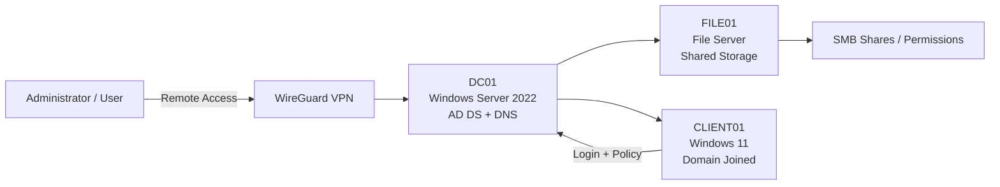

# Active Directory Homelab

A Windows Server 2022 Active Directory homelab built with Hyper-V to simulate a small business environment. This project focuses on core identity, access control, networking, and administration concepts commonly used in enterprise IT environments.

## Overview

This lab models a lightweight corporate infrastructure with:
- A domain controller
- A file server
- A Windows 11 client workstation
- Active Directory user and group management
- Group Policy enforcement
- Shared storage permissions
- Secure remote administration using WireGuard

The goal is to practice and validate real-world Windows server administration in a self-contained virtual lab environment.

## Technologies

- Windows Server 2022
- Active Directory Domain Services (AD DS)
- DNS
- Group Policy
- Hyper-V
- Windows 11
- WireGuard
- PowerShell

## Environment

The homelab consists of three primary virtual machines:

### DC01
Responsibilities:
- Active Directory
- DNS
- Domain services
- Central authentication and identity management

### FILE01
Responsibilities:
- File Server
- Shared Storage
- Access control for SMB shares

### CLIENT01
Responsibilities:
- Domain-joined workstation
- User logon validation
- Group Policy application
- End-user access testing

## Architecture Overview



## Active Directory Structure

The environment uses a basic corporate organizational model:

```text
CORP
├── Users
├── Groups
├── Computers
├── Servers
├── IT
├── HR
└── Service Accounts
```

This structure provides a simple foundation for organizing users, systems, and administrative access.

## Security Groups

The following security groups were created to support role-based access control:

- IT_Admins
- HR_Users
- File_RW
- File_RO
- Domain_Workstations

These groups were used to manage authorization across users, shared resources, and workstation access.

## Testing Performed

The environment was validated through several key tasks:

- Domain join validation
- Role-based access control (RBAC) testing
- Group Policy deployment
- Share permissions testing
- Remote administration via WireGuard

## Lessons Learned

- DNS is critical for Active Directory operations.
- Hyper-V Enhanced Session Mode can affect domain user logins.
- Security groups provide scalable and manageable access control.
- Group Policy is useful for centrally managing workstations and user settings.

## Practical Notes

This lab is useful for learning:
- Windows Server administration
- Domain controller setup and troubleshooting
- Group-based permissions
- File server configuration
- Identity lifecycle and access control fundamentals

## Screenshots

Below are placeholders for key screenshots from the setup and testing process.

### Architecture Diagram


### Domain Controller


### Active Directory Users and Computers


### Group Policy Management


### File Share Permissions


## Future Improvements

Potential enhancements for this lab include:
- Adding a second domain controller for redundancy
- Implementing OU-based policy segmentation
- Testing certificate services or PKI
- Expanding user groups and OU structures
- Adding monitoring and logging for domain activity

## Summary

This Active Directory homelab provides a practical, hands-on way to explore core Windows enterprise identity and access control concepts. It serves as a strong foundation for learning domain administration, security groups, centralized policy management, and remote infrastructure access.
